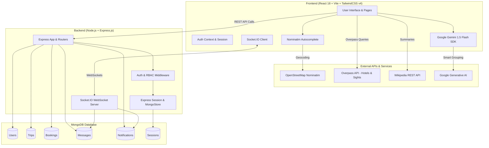
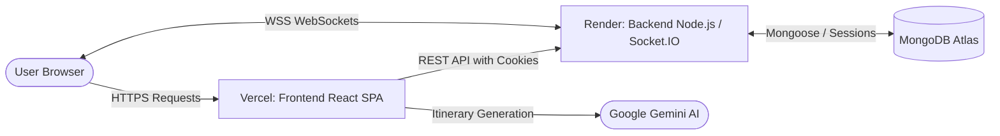

# 🌍pathora — Smart Group Travel Planning & Itinerary Generator

<div align="center">


<br/>

### ✈️ Plan Smarter. Explore Better. Travel Together.

**TravelAI is a full-stack, AI-powered group travel management ecosystem. It seamlessly automates itinerary creation, aggregates real-world accommodation and attraction data via OpenStreetMap & Wikipedia, provides real-time group collaboration with live chat and socket notifications, and implements an enterprise-grade 3-tier Role-Based Access Control (Admin, Organiser, User) system.**

[Key Features](#-key-features) • [Architecture](#-system-architecture) • [Tech Stack](#-tech-stack) • [Folder Structure](#-folder-structure) • [Getting Started](#-getting-started) • [Environment Variables](#-environment-variables) • [API Reference](#-api-reference) • [Socket.IO Events](#-real-time-socketio-events) • [User Roles & Workflows](#-user-roles--access-control) • [License](#-license)

</div>

---

## 🌟 Overview

Planning group journeys often involves complex logistics—coordinating schedules, balancing budgets, finding authentic attractions, managing bookings, and communicating across scattered messaging apps.

**TravelAI** bridges this gap by acting as an intelligent travel coordinator:
1. **Intelligent Destination Geocoding**: Queries the OpenStreetMap Nominatim API for accurate location resolution.
2. **Real-world Hotel & Attraction Fetching**: Executes Overpass API queries to gather verified local hotels, guest houses, viewpoints, museums, and historical landmarks.
3. **Contextual Cultural Summaries**: Leverages the Wikipedia REST API to extract rich descriptions and historical overviews for tourist spots.
4. **AI-driven Smart Itinerary Scheduling**: Employs Google Gemini AI (`gemini-1.5-flash`) to logically cluster attractions by proximity, opening hours, traveler preferences, and budget tier.
5. **Real-time Group Chat & Presence**: Provides WebSocket-powered group chats with media/photo sharing, emojis, and TTL auto-expiring messages.
6. **Multi-Role Administration**: Dedicated portals for trip organizers to curate members and site administrators to moderate users, trips, and bookings.

---

## ✨ Key Features

### 🤖 1. AI-Powered Smart Itinerary Generation
- **Dynamic Day-wise Planning**: Generates customized 1 to 7 day plans with morning, afternoon, and evening breakdowns.
- **Budget & Party Adaptation**: Calibrates recommendations for solo travelers, couples, families, and friend groups across *Budget*, *Standard*, and *Luxury* spending tiers.
- **Hybrid Real-Data AI Engine**: Combines real OpenStreetMap geographic data with Google Gemini AI for practical, non-hallucinated itineraries.
- **Intelligent Fallbacks**: Resilient fallback generation ensures itinerary delivery even during external service rate limits.

### 🏨 2. Hotel & Attraction Intelligence
- **Overpass API Integration**: Discovers hotels, guest houses, and landmarks within customizable kilometer radiuses.
- **Detailed Place Profiles**: Ratings, simulated travel times from city center, ticket pricing estimates, and optimal visiting windows.
- **Wikipedia Summaries**: Live Wikipedia extracts provide cultural context for each landmark.
- **Interactive Modals & Sliders**: Swiper carousels showcasing hotel amenities, photo galleries, and external booking redirects (e.g., OYO integration).

### 👥 3. Three-Tier Role-Based Access Control (RBAC)
- **Standard User**: Search destinations, generate AI trips, save favorites, submit join requests, chat with fellow travelers, and manage personal bookings.
- **Organiser**: Oversee managed trips, review incoming join requests, approve or reject group members, and coordinate trip logistics.
- **Admin**: Full moderation power—verify or revoke user access, approve pending trips before public listing, assign organiser privileges, and audit all system bookings.

### 💬 4. Real-time Group Chat & Media Sharing
- **Room-based Trip Channels**: Automatic assignment to `trip_{tripId}` rooms restricted exclusively to approved members and organizers.
- **Multimedia Support**: Send instant messages and upload base64-encoded photos directly within the chat.
- **Integrated Emoji Picker**: Expressive messaging via `emoji-picker-react`.
- **Message Expiration (TTL)**: Automatic 24-hour message cleanup via MongoDB TTL indexes once read.

### 🔔 5. Live Notification System
- **Real-time Push Alerts**: WebSocket events dispatch alerts to personal `user_{userId}` channels.
- **Interactive Header Bell**: Dropdown with unread counter badges, timestamped previews, "Mark Read", and "Mark All Read" utilities.
- **Triggered Events**: Instant alerts on new chat messages, booking approvals, rejections, and new member join requests.

### 🧭 6. Community Trip Discovery & Exploration
- **Public Trip Feed**: Browse curated itineraries verified and approved by administrators.
- **Multi-parameter Filtering**: Filter by destination keywords, duration (min/max days), and budget category.
- **One-Click Join**: Quick "Request to Join" flow with a simulated VISA checkout workflow.

---

## 🏛️ System Architecture



---

## 🛠️ Tech Stack

### Core Technologies

| Layer | Technology | Description |
|---|---|---|
| **Frontend Framework** | [React 18.3](https://react.dev/) | Component-driven UI library with hooks & context state management |
| **Build Tool** | [Vite (Rolldown)](https://vitejs.dev/) | Ultra-fast build tool and local development server |
| **Routing** | [React Router DOM v7](https://reactrouter.com/) | Client-side declarative routing and layout hierarchies |
| **Styling** | [Tailwind CSS v4](https://tailwindcss.com/) + `@tailwindcss/vite` | Utility-first styling engine with modern CSS theme tokens |
| **UI Primitives** | [Radix UI](https://www.radix-ui.com/) | Accessible dialogs, dropdowns, scroll areas, and toggles |
| **Icons** | [Lucide React](https://lucide.dev/) | Clean, lightweight icon pack |
| **Sliders / Carousels** | [Swiper 12](https://swiperjs.com/) | Touch-friendly image sliders and gallery viewers |
| **Backend Framework** | [Express.js 4.19](https://expressjs.com/) | Robust REST API server for Node.js (ES Module format) |
| **Runtime** | [Node.js 18+](https://nodejs.org/) | Asynchronous server-side JavaScript engine |
| **Database** | [MongoDB](https://www.mongodb.com/) + [Mongoose 8](https://mongoosejs.com/) | NoSQL document database with strict schema validation |
| **Session & Auth** | [express-session](https://github.com/expressjs/session) + [connect-mongo](https://github.com/jdesboeufs/connect-mongo) | Cookie-based session persistence stored securely in MongoDB |
| **Real-time Engine** | [Socket.IO 4.8](https://socket.io/) | Full-duplex WebSocket communication with session sharing |
| **AI Engine** | [Google Generative AI](https://ai.google.dev/) (`gemini-1.5-flash`) | Contextual day itinerary scheduling & grouping |
| **Geospatial APIs** | [OpenStreetMap Nominatim](https://nominatim.org/) & [Overpass API](https://overpass-api.de/) | Open-source geocoding, hotels, and attractions queries |
| **Content API** | [Wikipedia REST API](https://www.mediawiki.org/wiki/API:REST_API) | Encyclopedic attraction summaries and cultural insights |

---

## 📁 Folder Structure

```text
Travel-ai/
├── package.json                 # Monorepo/Root package orchestration (concurrently)
├── README.md                    # Project documentation
├── LICENSE                      # MIT License
│
├── client/                      # Frontend Application (React + Vite)
│   ├── index.html               # Single Page Application HTML entry
│   ├── vite.config.js           # Vite configuration with Tailwind & path aliases
│   ├── jsconfig.json            # Path alias resolution (@ -> src)
│   ├── eslint.config.js         # ESLint 9 linting rules
│   ├── package.json             # Frontend dependencies and build scripts
│   ├── public/                  # Static assets (logos, placeholder hotels, attractions)
│   └── src/
│       ├── main.jsx             # React DOM root & BrowserRouter routing tree
│       ├── App.jsx              # Landing page wrapper
│       ├── App.css              # Custom styling adjustments
│       ├── index.css            # Tailwind CSS v4 directives & color palette tokens
│       ├── Layout.jsx           # Global layout wrapper containing persistent Header
│       │
│       ├── chat/                # Real-time Chat Page
│       │   └── index.jsx        # Room selector, chat history, image/text sender
│       │
│       ├── components/          # Reusable UI & Custom Components
│       │   ├── custom/
│       │   │   ├── Header.jsx         # Sticky navigation with role panels & notifications
│       │   │   ├── Hero.jsx           # High-impact landing page hero section
│       │   │   ├── TravelLoader.jsx   # Custom animated loading indicator
│       │   │   └── TripFilters.jsx    # Search, duration & budget filtering controls
│       │   ├── chat/
│       │   │   └── GroupChat.jsx      # Modal-based destination chat with emoji picker
│       │   ├── pages/
│       │   │   ├── About.jsx          # Platform overview and company mission
│       │   │   └── Contact.jsx        # Contact support & inquiries form
│       │   ├── ui/                    # Base UI components (Radix + Tailwind)
│       │   │   ├── button.jsx         # Accessible button with CVA variants
│       │   │   ├── dialog.jsx         # Accessible modal dialog
│       │   │   ├── dropdown-menu.jsx  # Dropdown action menus
│       │   │   ├── scroll-area.jsx    # Custom slim scrollbars
│       │   │   ├── toast.jsx          # Dynamic notifications / toast provider
│       │   │   ├── TripCard.jsx       # Card displaying individual hotel / place details
│       │   │   └── UserTripCard.jsx   # Card displaying community-shared trips
│       │   ├── ItinerarySection.jsx   # Collapsible daily itinerary timeline with favorites
│       │   ├── NominatimAutocomplete.jsx # Real-time OSM destination search bar
│       │   ├── NotificationDropdown.jsx  # Interactive live notification bell menu
│       │   └── PaymentModal.jsx       # Simulated credit card checkout modal
│       │
│       ├── constants/
│       │   └── options.jsx      # Traveler types (Solo, Couple, Family) & Budget definitions
│       │
│       ├── context/
│       │   └── AuthContext.jsx  # Global session authentication provider & hook (`useAuth`)
│       │
│       ├── create-trip/
│       │   └── index.jsx        # Interactive trip generation wizard form
│       │
│       ├── lib/
│       │   └── utils.js         # Styling utility helpers (clsx + tailwind-merge)
│       │
│       ├── my-trips/
│       │   └── index.jsx        # Dashboard for created trips, bookings & creator requests
│       │
│       ├── pages/               # Main Application Views
│       │   ├── AdminDashboard.jsx     # Admin panel (user, trip, booking management)
│       │   ├── Explore.jsx            # Community trip explorer with live filters
│       │   ├── Login.jsx              # Session login view
│       │   ├── OrganiserDashboard.jsx # Organiser panel for managing trips & requests
│       │   ├── Profile.jsx            # User profile editor & password security
│       │   └── Register.jsx           # New user registration with validation
│       │
│       ├── service/
│       │   ├── AIModel.jsx      # Gemini AI prompt engine, OSM Overpass & Wiki fetchers
│       │   └── api.jsx          # Axios instance configured with cookie credentials
│       │
│       └── view-trip/           # Detailed Trip Presentation
│           ├── index.jsx        # Comprehensive trip viewer with hotels & day plans
│           └── ViewDetails.jsx  # Detailed view for specific hotels/attractions
│
└── server/                      # Backend Application (Node.js + Express)
    ├── index.js                 # HTTP & Socket.IO server, DB connection & SPA fallback
    ├── package.json             # Server dependencies & nodemon runner
    │
    ├── middleware/
    │   └── authMiddleware.js    # Session verifiers: verifyToken, verifyAdmin, verifyOrganiser
    │
    ├── models/                  # Mongoose Data Schemas
    │   ├── Admin.js             # Dedicated Admin schema
    │   ├── Booking.js           # Trip joining requests & accommodation reservations
    │   ├── Message.js           # Group chat messages with TTL auto-expiry index
    │   ├── Notification.js      # System and user notification schema
    │   ├── Trip.js              # Generated trip plan with AI JSON data & metadata
    │   └── User.js              # User profiles with roles, verification, favorites & bio
    │
    └── routes/                  # Express RESTful Route Handlers
        ├── auth.js              # Registration, session login, logout & session validation
        ├── bookings.js          # Booking requests, join validation, member listings
        ├── messages.js          # Trip chat history retrieval
        ├── notifications.js     # User notifications & read status management
        ├── organiser.js         # Managed trip retrieval & join request moderation
        ├── trips.js             # Trip creation, public search, status update, deletion
        └── users.js             # User administration, profile updates & password changes
```

---

## 🚀 Getting Started

### Prerequisites

Ensure you have the following installed on your local environment:
- **Node.js**: `v18.0.0` or higher ([Download Node.js](https://nodejs.org/))
- **npm**: `v9.0.0` or higher
- **MongoDB**: A running local MongoDB instance or a free [MongoDB Atlas](https://www.mongodb.com/atlas/database) cloud cluster.
- **Google Gemini API Key**: Free API key from [Google AI Studio](https://aistudio.google.com/).

---

### Step-by-Step Installation

#### 1. Clone the Repository
```bash
git clone https://github.com/vivekVerma2806/Travel-ai.git
cd Travel-ai
```

#### 2. Install Dependencies
Run the root helper script to install all packages for both the `client` and `server`:
```bash
npm run install-all
```

Alternatively, install them individually:
```bash
# Install root orchestration tools
npm install

# Install client packages
cd client && npm install

# Install server packages
cd ../server && npm install
cd ..
```

---

## 🔐 Environment Variables

The project requires environment configuration files in both `client/` and `server/`.

### 1. Backend Environment (`server/.env`)

Create a `.env` file inside the `server/` directory:

```env
# Server Port (Render provides PORT automatically in production)
PORT=5001

# MongoDB Connection String (Atlas URI or local MongoDB)
MONGO_URI=mongodb+srv://<username>:<password>@cluster0.mongodb.net/travelai?retryWrites=true&w=majority

# Secret key for encrypting express-session cookies (minimum 32 characters)
SESSION_SECRET=your_super_secret_session_encryption_key_here

# Environment Mode ('development' | 'production')
NODE_ENV=production

# Frontend URL deployed on Vercel (used by CORS and Socket.IO)
CLIENT_URL=https://your-frontend-app.vercel.app
```

| Variable | Required | Default | Description |
|---|---|---|---|
| `PORT` | Optional | `5000` (Recommend `5001` for dev) | Port where the Express/Socket server listens |
| `MONGO_URI` | **Yes** | — | Connection URI for MongoDB database |
| `SESSION_SECRET` | **Yes** | Auto-generated in dev | Secret string used to sign session cookies |
| `NODE_ENV` | Optional | `development` | Sets cookie security (`secure: true` in production) |
| `CLIENT_URL` | **Yes (Prod)** | — | Vercel frontend URL for CORS & Socket.IO whitelist |
| `ALLOWED_ORIGINS`| Optional | — | Comma-separated list of additional allowed origins |

---

### 2. Frontend Environment (`client/.env`)

Create a `.env` file inside the `client/` directory:

```env
# Google Gemini Generative AI API Key
VITE_GOOGLE_GEMINI_AI_API_KEY=AIzaSyYourGeminiApiKeyHere

# Backend URL deployed on Render (without trailing slash)
VITE_BACKEND_URL=https://your-backend-service.onrender.com
```

| Variable | Required | Description |
|---|---|---|
| `VITE_GOOGLE_GEMINI_AI_API_KEY` | **Yes** | Google Gemini API key obtained from [Google AI Studio](https://aistudio.google.com/) |
| `VITE_BACKEND_URL` | **Yes (Prod)** | Render backend URL (e.g., `https://travel-ai-backend.onrender.com`) |
| `VITE_API_URL` | Optional | Explicit API endpoint (defaults to `${VITE_BACKEND_URL}/api`) |

---

## 🚀 Deploying to Vercel (Frontend) & Render (Backend)

Follow these steps to deploy TravelAI with the frontend on **Vercel** and the backend on **Render**:



### Step 1: Deploy Backend on Render

1. Go to [Render Dashboard](https://dashboard.render.com/) and click **New +** ➔ **Web Service**.
2. Connect your GitHub repository (`Travel-ai`).
3. Configure the service settings:
   - **Name**: `travel-ai-backend` (or your choice)
   - **Region**: Choose the closest region to your users
   - **Root Directory**: `server`
   - **Environment**: `Node`
   - **Build Command**: `npm install`
   - **Start Command**: `node index.js`
   - **Instance Type**: `Free`
4. Under **Environment Variables**, add:
   - `NODE_ENV`: `production`
   - `PORT`: `10000` (or leave default, Render sets `PORT` automatically)
   - `MONGO_URI`: `mongodb+srv://<username>:<password>@cluster0.mongodb.net/travelai?retryWrites=true&w=majority`
   - `SESSION_SECRET`: Generate a random 32+ character string
   - `CLIENT_URL`: `https://your-app-name.vercel.app` *(update this after creating Vercel app)*
5. Click **Create Web Service**. Wait for the deployment to complete.
6. Verify the backend is live by opening `https://<your-render-service>.onrender.com/health` in your browser. It should return:
   ```json
   { "status": "ok", "uptime": 12.34 }
   ```

---

### Step 2: Deploy Frontend on Vercel

1. Go to [Vercel Dashboard](https://vercel.com/dashboard) and click **Add New...** ➔ **Project**.
2. Import your GitHub repository (`Travel-ai`).
3. In the project configuration screen:
   - **Framework Preset**: `Vite`
   - **Root Directory**: Click *Edit* and select **`client`**
   - **Build Command**: `npm run build`
   - **Output Directory**: `dist`
   - **Install Command**: `npm install`
4. Under **Environment Variables**, add:
   - `VITE_GOOGLE_GEMINI_AI_API_KEY`: Your Gemini API Key from Google AI Studio
   - `VITE_BACKEND_URL`: Your Render backend URL (e.g., `https://travel-ai-backend.onrender.com` without trailing slash)
5. Click **Deploy**.
6. Once deployed, copy your production Vercel domain (e.g., `https://travel-ai-client.vercel.app`).

---

### Step 3: Link Vercel Domain to Render CORS

1. Go back to your [Render Dashboard](https://dashboard.render.com/) ➔ select `travel-ai-backend`.
2. Go to **Environment** tab.
3. Update the `CLIENT_URL` variable with your actual Vercel domain:
   ```env
   CLIENT_URL=https://travel-ai-client.vercel.app
   ```
4. Render will automatically redeploy with the updated CORS whitelist.

---

### Step 4: Verify Deployment

1. Visit your Vercel URL: `https://travel-ai-client.vercel.app`.
2. Open DevTools (F12) ➔ Network and Console tabs.
3. Test **User Registration / Login**:
   - Verify that cookies (`connect.sid`) are stored with `SameSite=None; Secure`.
4. Test **AI Trip Generation**:
   - Search a destination, pick days, and generate an itinerary.
5. Test **Real-time Chat & Notifications**:
   - Verify the Socket.IO connection status in the Console (`Socket Connected!`).

---

## 📜 Available Scripts

| Command | Location | Description |
|---|---|---|
| `npm run dev` | Root | Runs frontend (`vite`) and backend (`nodemon`) concurrently |
| `npm run install-all` | Root | Sequentially installs dependencies in `client/` and `server/` |
| `npm run client` | Root | Starts the Vite development server for the frontend only |
| `npm run server` | Root | Starts the backend server with `nodemon` auto-reload |
| `npm run build` | Root / Client | Compiles the production frontend bundle into `client/dist/` |
| `npm run start` | Root / Server | Starts the backend Node.js server in production mode |
| `npm run lint` | Client | Runs ESLint 9 across the React codebase |

---

## 📡 API Reference

All backend API routes are prefixed with `/api`. Session authentication is verified via secure `connect.sid` HTTP cookies.

### 🔑 Authentication Routes (`/api/auth`)

| Method | Endpoint | Access | Description |
|---|---|---|---|
| `GET` | `/api/auth/me` | Logged In | Fetches active session user details & roles |
| `POST` | `/api/auth/register` | Public | Registers a new user account with hashed password |
| `POST` | `/api/auth/login` | Public | Authenticates credentials and initiates an HTTP-only session |
| `POST` | `/api/auth/logout` | Logged In | Destroys current session and clears session cookie |
| `GET` | `/api/auth/test-db` | Public | Diagnostic sanity check for DB connectivity |

---

### 🗺️ Trips Routes (`/api/trips`)

| Method | Endpoint | Access | Description |
|---|---|---|---|
| `POST` | `/api/trips` | Authenticated | Saves newly generated AI itinerary and metadata |
| `GET` | `/api/trips` | Public | Retrieves approved public trips with destination/budget/day filters |
| `GET` | `/api/trips/user-trips` | Authenticated | Retrieves all trips created by the logged-in user |
| `GET` | `/api/trips/:id` | Public | Retrieves detailed trip data by MongoDB ObjectId |
| `DELETE` | `/api/trips/:id` | Owner / Admin | Deletes trip with cascading deletion of bookings and messages |
| `GET` | `/api/trips/admin/all` | Admin Only | Retrieves all trips (pending, approved, rejected) |
| `PATCH` | `/api/trips/:id/status` | Admin Only | Updates trip approval status (`pending`, `approved`, `rejected`) |
| `PATCH` | `/api/trips/:id/organiser-status` | Admin Only | Approves trip organizer request and upgrades user role |

---

### 📅 Bookings & Join Requests (`/api/bookings`)

| Method | Endpoint | Access | Description |
|---|---|---|---|
| `POST` | `/api/bookings/join` | Authenticated | Submits a request to join a specific trip or book destination |
| `GET` | `/api/bookings/status/:destination` | Authenticated | Checks existing booking/join status for a destination |
| `GET` | `/api/bookings/user-bookings` | Authenticated | Retrieves all bookings made by the current user |
| `GET` | `/api/bookings/creator-requests` | Authenticated | Retrieves join requests for trips created by current user |
| `GET` | `/api/bookings/trip/:tripId/members` | Authenticated | Returns all approved members for a given trip |
| `DELETE` | `/api/bookings/:id` | Owner | Cancels/deletes user's own booking request |
| `GET` | `/api/bookings/admin/all` | Admin Only | Returns all bookings across the platform |
| `GET` | `/api/bookings/admin/pending` | Admin Only | Returns all pending booking requests |
| `GET` | `/api/bookings/admin/approved` | Admin Only | Returns all approved bookings |
| `PUT` | `/api/bookings/admin/validate/:id` | Admin Only | Validates and updates booking status (`approved` / `rejected`) |
| `DELETE` | `/api/bookings/admin/:id` | Admin Only | Permanently deletes a booking record |

---

### 🛡️ Organiser Management (`/api/organiser`)

| Method | Endpoint | Access | Description |
|---|---|---|---|
| `GET` | `/api/organiser/my-managed-trips` | Organiser / Admin | Retrieves trips assigned to and managed by the organizer |
| `GET` | `/api/organiser/join-requests` | Organiser / Admin | Retrieves incoming join requests for managed trips |
| `PUT` | `/api/organiser/requests/:id/validate` | Organiser / Admin | Approves or rejects a user request for a managed trip |

---

### 👤 Users & Profiles (`/api/users`)

| Method | Endpoint | Access | Description |
|---|---|---|---|
| `GET` | `/api/users/profile` | Authenticated | Retrieves full profile details for logged-in user |
| `PUT` | `/api/users/profile` | Authenticated | Updates user profile fields (bio, phone, avatar, username) |
| `PUT` | `/api/users/change-password` | Authenticated | Verifies old password and hashes updated password |
| `POST` | `/api/users/favorites/:tripId` | Authenticated | Toggles a trip in the user's favorites list |
| `GET` | `/api/users` | Admin Only | Lists all registered regular users |
| `PATCH` | `/api/users/:id/verify` | Admin Only | Approves and verifies user account (`isVerified: true`) |
| `PATCH` | `/api/users/:id/revoke` | Admin Only | Revokes verified status (`isVerified: false`) |
| `DELETE` | `/api/users/:id` | Admin Only | Deletes user with full cascade cleanup (trips, bookings, messages) |

---

### 💬 Chat Messages (`/api/messages`)

| Method | Endpoint | Access | Description |
|---|---|---|---|
| `GET` | `/api/messages/:tripId` | Approved Member / Admin | Retrieves chronological chat history for a trip |

---

### 🔔 Notifications (`/api/notifications`)

| Method | Endpoint | Access | Description |
|---|---|---|---|
| `GET` | `/api/notifications` | Authenticated | Retrieves recent notifications for the logged-in user |
| `PUT` | `/api/notifications/:id/read` | Authenticated | Marks notification as read; triggers 24h message TTL |
| `PUT` | `/api/notifications/mark-all-read` | Authenticated | Marks all unread user notifications as read |

---

## ⚡ Real-Time Socket.IO Events

The application establishes a persistent bi-directional WebSocket connection between client and server, bound to the user's active session.

### Connection & Authentication
```javascript
import { io } from "socket.io-client";

const socket = io("http://localhost:5001", {
  withCredentials: true // Passes express-session cookie
});
```

### Event Specifications

| Event Name | Direction | Payload | Description |
|---|---|---|---|
| `join_chat` | Client ➔ Server | `{ tripId: string }` | Requests entrance into `trip_${tripId}` room (membership verified) |
| `joined_room` | Server ➔ Client | `{ room: string }` | Confirms successful access to the trip chat room |
| `send_message` | Client ➔ Server | `{ tripId, message, type, imageUrl }` | Transmits a text or photo message to the group |
| `receive_message` | Server ➔ Client | `{ _id, tripId, author, senderId, message, type, imageUrl, time }` | Broadcasts new message to all active room members |
| `notification_new` | Server ➔ Client | Notification Object | Pushes live notification to personal channel `user_${userId}` |
| `error` | Server ➔ Client | `{ message: string }` | Dispatches socket-level permission or validation error |

---

## 👥 User Roles & Access Control

```text
┌─────────────────────────────────────────────────────────────┐
│                          User Roles                         │
└─────────────────────────────────────────────────────────────┘
                               │
         ┌─────────────────────┼─────────────────────┐
         ▼                     ▼                     ▼
     [ User ]            [ Organiser ]           [ Admin ]
  - Generate Trips     - Manage Assigned     - Full System Access
  - Browse Explore       Trips               - Verify/Ban Users
  - Request to Join    - Approve/Reject      - Approve Public Trips
  - Group Chat (Room)    Join Requests       - Assign Organisers
  - Profile & Favs     - Coordinate Group    - Audit All Bookings
```

### 1. User Workflow
1. **Registration & Login**: User registers with username, email, and password.
2. **AI Trip Wizard**: Navigates to `/create-trip`, enters destination via OpenStreetMap search, chooses duration (1–7 days), budget, and party type.
3. **Save & View**: Generated trip displays interactive daily itineraries, OSM hotel listings, and attraction details.
4. **Join & Collaborate**: Submits a join request for community trips; once approved by the organizer, gains full access to the real-time group chat.

### 2. Organiser Workflow
1. **Organiser Request**: Trip creators can request organizer status when publishing trips.
2. **Review & Governance**: Once elevated by an admin, accesses `/organiser`.
3. **Manage Members**: Reviews applicants under "Join Requests", inspecting traveler profiles before approving or rejecting.
4. **Group Facilitation**: Participates in the trip group chat to answer questions and coordinate schedules.

### 3. Administrator Workflow
1. **Panel Access**: Users with `role: 'admin'` see the red **Panel** button leading to `/admin`.
2. **User Auditing**: Inspects registered accounts, toggles verification status, or deletes problematic accounts (with complete cascade data cleanup).
3. **Trip Moderation**: Approves pending itineraries to publish them onto the `/explore` community page.
4. **Booking Control**: Inspects and validates booking statuses across all system destinations.

---

## ❓ Troubleshooting & FAQs

### Q: Why do my API requests return 401 Unauthorized after logging in?
> **Answer**: TravelAI utilizes cookie-based session authentication (`express-session` + `connect-mongo`).
> - Ensure your requests are made with `credentials: true` (configured automatically in `client/src/service/api.jsx`).
> - Ensure the client and server domains match or CORS allows credentials from your client port (`http://localhost:5173`).
> - If running locally, check that `server/.env` has `NODE_ENV=development` so cookies are not restricted to HTTPS.

### Q: Socket connection fails with "Authentication error: No session found"?
> **Answer**: Socket.IO shares authentication with the Express session. Make sure you log in successfully before navigating to the chat, and ensure your browser has saved the `connect.sid` cookie.

### Q: The AI trip generator returns fallback hotels or takes long to respond?
> **Answer**: TravelAI makes real-time Overpass API queries to OpenStreetMap servers. If the Overpass API is experiencing high traffic or the location query is too broad, the system gracefully falls back to structured templates so trip planning is never interrupted.

### Q: How do I create the initial Admin account?
> **Answer**: Register a new user through `/register`, connect to your MongoDB database (via MongoDB Compass or Mongo shell), find the user in the `users` collection, and update their role:
> ```json
> { "$set": { "role": "admin", "isVerified": true } }
> ```

---

## 🤝 Contributing

Contributions are warmly welcome! To contribute:

1. **Fork the Repository**
2. **Create a Feature Branch**:
   ```bash
   git checkout -b feature/AmazingFeature
   ```
3. **Commit Your Changes**:
   ```bash
   git commit -m "Add AmazingFeature"
   ```
4. **Push to the Branch**:
   ```bash
   git push origin feature/AmazingFeature
   ```
5. **Open a Pull Request**

---

## 📄 License

Distributed under the **MIT License**. See [`LICENSE`](./LICENSE) for full details.

---

<div align="center">

**Developed with ❤️ by [Vivek Kumar Verma](https://github.com/vivekVerma2806)**

⭐ **If you find TravelAI helpful or inspiring, please give this repository a star!** ⭐

</div>
